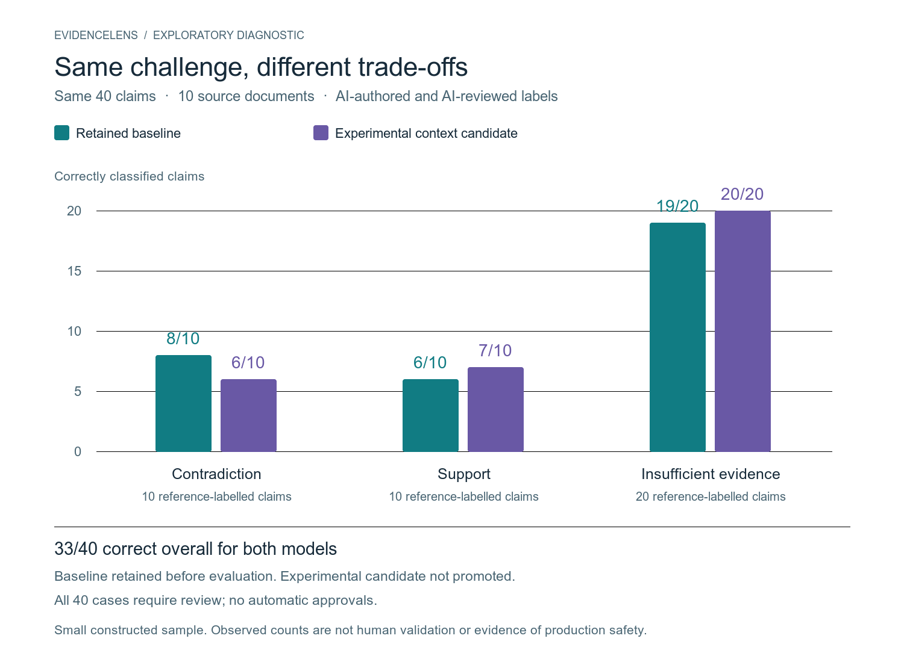

# EvidenceLens

Protótipo local para ajudar uma pessoa a comparar afirmações com trechos de referência. **Não é detector universal de alucinação, não verifica a verdade da fonte e não está validado para produção.**

## O que esta publicação contém

- Demo de revisão por frase, com sinais lexicais e exportação local de decisões.
- Classificador didático de regressão logística, treinado localmente em exemplos sintéticos próprios.
- Código Python sem dependências externas, interface local e testes.
- Resumo dos experimentos de pesquisa, incluindo resultados negativos e limites.

A demo **não executa os modelos semânticos da pesquisa**. Não há pesos pré-treinados, datasets externos, abstracts científicos, dados pessoais ou serviço hospedado neste repositório. Os scripts e artefatos locais dos experimentos não estão incluídos: este pacote reproduz a demo sintética, não os estudos completos.

## Executar

Python 3.10 ou posterior. Sem instalação de bibliotecas ou chaves de API.

```sh
python3 train.py
python3 -m unittest discover -s tests -v
python3 serve.py 8766
```

Abra http://127.0.0.1:8766. O primeiro comando cria os dados sintéticos e os pesos didáticos em `data/` e `artifacts/`, ignorados pelo Git. O treinamento usa templates compartilhados entre as divisões: suas métricas são testes da infraestrutura, **não evidência de generalização semântica**.

O servidor escuta somente a interface local. Não o exponha à internet. A interface não usa APIs externas e não salva revisões automaticamente no servidor. O arquivo JSON exportado contém os textos inseridos: confira-o antes de compartilhar.

## Interpretar a revisão

- `matched`: coincidência literal, não confirmação da verdade.
- `review`: possível divergência lexical ou numérica.
- `abstain`: apoio não estabelecido; paráfrases corretas também podem cair aqui.

O score do modelo é um indicador secundário, não probabilidade calibrada de erro. Baixa prioridade **não aprova** uma afirmação. Todo uso exige revisão humana, especialmente em conteúdo médico, jurídico ou financeiro. A demo não substitui profissionais.

## Pesquisa e resultados

Experimentos locais posteriores avaliaram inferência textual e recuperação de evidências, separados desta demo. Na última reserva, com **40 alegações construídas e revisadas por IA sobre dez documentos**, baseline e candidatos acertaram **33/40**. As candidatas reconheceram 20/20 insuficientes em vez de 19/20, mas reconheceram menos contradições: 6/10 em vez de 8/10. Não houve ganho geral demonstrado ou promoção ao aplicativo.

Essa amostra não representa uso real. Não houve validação humana independente; os resultados não estimam segurança em produção. Leia [o resumo da pesquisa](docs/RESEARCH_SUMMARY.md) e [as limitações](docs/LIMITATIONS.md).

## Same-challenge comparison



Observed counts on one constructed challenge, not a comparison across datasets. Class sizes differ (10 contradictions, 10 supports, 20 insufficient-evidence cases); fractions give the denominator for each bar. Labels were authored and reviewed by AI, not independently validated by humans. The baseline was retained before evaluation; the experimental candidate was not promoted. **20/20 observed cases does not establish safety or generalization.**

[Vector figure](docs/figures/same-challenge-results.svg) · [Aggregate source data](docs/figures/same-challenge-results.json) · [Rendering script](scripts/render_results_figure.py)

Regenerate the SVG with `python3 scripts/render_results_figure.py` (Python standard library only). PNG rendering optionally uses ImageMagick. The figure and aggregate visualization data are original project material under MIT; source datasets retain their own licenses.

## Lotes locais

Prepare JSONL com `evidence` e `answer` por linha e, opcionalmente, `id`:

```sh
python3 review_batch.py entrada.jsonl revisao-nova.jsonl
```

A saída precisa ser um arquivo novo. Todos os registros válidos ficam com revisão humana pendente. Não envie textos confidenciais a serviços externos sem autorização.

## Licença e autoria

Código e documentação originais sob [MIT](LICENSE). Materiais de terceiros usados apenas na pesquisa possuem termos próprios, descritos em [proveniência e licenças](docs/PROVENANCE.md). A licença deste código não concede direitos sobre esses materiais.

Desenvolvido com assistência de IA. O responsável deve revisar decisões, código e afirmações antes de usar ou apresentar o projeto. Sem afiliação declarada com fornecedores dos modelos ou datasets.
